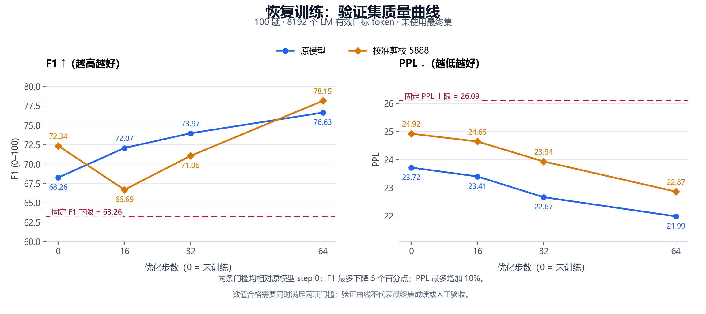

# 实验结果与交付验证

日期：2026-09-27。单台 RTX 4060 Laptop 8GB，16GB 系统内存；固定版本和协议见 [METHODS](METHODS.md)。公开数据为从完整本地报告生成的展示摘要，原报告 SHA 见 [metrics.json](../reports/metrics.json)，不是修改路径后的伪原始记录。

## 固定产物的质量

四个模型在最终评测之前固定，没有根据 final 改选、重训或放宽门槛。validation 100题／8192 LM目标，final 200题／16384 LM目标。

| 用途 | 模型 | EM | F1 | PPL | 达到64 token上限 |
| --- | --- | ---: | ---: | ---: | ---: |
| validation | original_step0 | 38.00 | 68.2635 | 23.7206 | 0 |
| validation | calibrated_5888_step0 | 38.00 | 72.3449 | 24.9234 | 3 |
| validation | original_step64_merged | 43.00 | 77.4107 | 21.9850 | 2 |
| validation | calibrated_5888_step64_merged | 39.00 | 78.1983 | 22.8703 | 4 |
| final | original_step0 | 67.50 | 84.7006 | 22.7745 | 0 |
| final | calibrated_5888_step0 | 63.50 | 82.7126 | 23.7624 | 1 |
| final | original_step64_merged | 67.00 | 86.0512 | 21.0195 | 2 |
| final | calibrated_5888_step64_merged | 61.00 | 83.3852 | 21.6728 | 4 |

最终剪后恢复版比未训练原模型 F1 低1.3154个百分点，PPL低4.84%，通过事先设定的 F1降≤5个百分点、PPL增≤10% 数值门槛。但同训练64步原模型 F1为86.0512，剪后为83.3852；EM低6个百分点、PPL高3.11%。不能说剪枝带来了普遍能力提升。EM并非本次数值门槛，仍完整报告其下降。

## 回答复核

助手阅读最终200题的全部800条回答，并回看30个资料段落；严格连续重复、问题原样复述和空答均为0，剪后恢复版4条达到生成上限。未观察到广泛循环，但仍有关系错配、数量错误和答案范围过长。它不等于用户或独立人工验收。

例如，两种恢复版都把一个“祭祀目的”问题错答为头骨佩戴方式；另有把体高答成体长／体高比值的问题。剪后版相对同预算原模型也修复了一些题，不能只列坏例或只列好例。完整固定筛查口径、全部cap和案例见 [最终答案复核](../reports/final_review.md)。

## 参数与实测资源

两种合并模型去重参数分别为1,720,574,976与1,676,534,784，减少44,040,192（2.55962%）。BF16去重权重存储少88,080,384字节，即84 MiB。合并后不再携带单独的LoRA推理支路。

512 token输入、固定32输出时，两轮生成张量分配峰值的最大值由 **3.4148 GiB降至3.3328 GiB，减少84 MiB（2.40%）**。这不是整卡占用，也不是任意上下文长度的显存保证。

**未观察到稳定加速。** 正反序两轮、每轮7次计时的范围与方向不足以支持加速结论。相对原始未训练模型，剪后恢复版在128输入的首token和解码上出现两轮范围分离的变慢；相对同预算原64，两种输入的加速条件均不成立。不要把这种单机描述直接归因于剪枝算法，也不要挑最快一次代表性能。

完整四模型／两轮／两种长度的中位数、最小最大值、allocated与reserved及限制见 [资源报告](../reports/resources.md)。原模型快照重复序列化 tied embedding/lm_head，合并保存去除了重复；文件体积节省包含这一因素，不能把原快照到剪后文件的全部下降称为剪枝压缩率。

## 早期失败对照也保留

以下为旧版同协议100题validation、8192 LM目标的独立网格，不能与上面的合并产物直接混作同协议比较。每种宽度均从同一个干净原模型独立裁剪。

| 评分 | MLP宽度 | 参数减少 | EM | F1 | PPL | 数值门槛 |
| --- | ---: | ---: | ---: | ---: | ---: | --- |
| original | 6144 | 0.00% | 38.00 | 68.2635 | 23.7206 | 基准 |
| joint_l2_squared | 5888 | 2.56% | 13.00 | 37.3652 | 172.2336 | 未通过 |
| calibrated_rms_mean_abs | 5888 | 2.56% | 38.00 | 72.3449 | 24.9234 | 通过 |
| joint_l2_squared | 5632 | 5.12% | 1.00 | 2.8702 | 285.2827 | 未通过 |
| calibrated_rms_mean_abs | 5632 | 5.12% | 12.00 | 46.9287 | 26.3439 | 未通过 |

本结果支持继续校准5888这一有限分支，不足以证明所有幅值方法无效或Qwen不可剪。候选的选择规则是在已知5888校准结果之后、5632校准运行之前记录，不能称整个探索完全预注册。

## 全部恢复检查点

这部分是未合并的FP32 LoRA支路结果，保留原始训练阶段口径；发布最终质量使用上面的BF16合并模型。每边64次更新／512条／6762监督token，按预先固定的validation规则各选64步；cal16的退化没有省略。

| 分支 | 步数 | EM | F1 | PPL |
| --- | ---: | ---: | ---: | ---: |
| original | 0 | 38.00 | 68.2635 | 23.7206 |
| original | 16 | 37.00 | 72.0699 | 23.4052 |
| original | 32 | 43.00 | 73.9652 | 22.6698 |
| original | 64 | 42.00 | 76.6329 | 21.9889 |
| calibrated_5888 | 0 | 38.00 | 72.3449 | 24.9234 |
| calibrated_5888 | 16 | 24.00 | 66.6944 | 24.6460 |
| calibrated_5888 | 32 | 40.00 | 71.0595 | 23.9365 |
| calibrated_5888 | 64 | 39.00 | 78.1519 | 22.8667 |

两次合并均验证84个目标矩阵符合PEFT合并算术，其他参数不变；保存重载全部参数hash一致，8个恢复资料探针误差为0。合并前后logits本身不逐位相等，因此进行了发布版重评测；这8个探针也不等于所有输入等价。

## 工具与发布验证

- 本机完整目录：328项CPU测试全部通过，包括六项真实冻结数据检查。
- 不含历史data/results/model的公开staging：实际执行322项并全部通过；含6项真实数据检查的测试类整体跳过（unittest记为1个class skip）；使用同一已验证环境及本地SHA匹配的Punkt缓存，不声称又完整下载并训练了一次模型。
- 安装依赖检查 `pip check` 通过；Windows完整环境版本见 [freeze](../reports/environment-windows.freeze.txt)。Linux CPU CI状态以GitHub实际运行记录为准。
- 两个step64完整模型已真实导出并重载；8份发布质量报告及8个独立资源进程均完成。
- 自定义题库入口真实运行3条自编示例，2条有参考、1条无参考且不评分；保留“必须先断开电源”等真实答案，不为提高分数删词。
- 自定义校准1段399 token资料明确取前256 token，真实采集28层，每层计数256，统计保存重载完全一致；仅验证入口，不以1段宣称校准有效或开启新剪枝实验。
- PowerShell入口与教程命令块语法检查通过，固定来源文件／许可核对通过，公开包不含模型权重、私有路径或Punkt缓存。

本机首次和重试下载Punkt时遇到上游断开连接，因此staging测试复用了已有SHA匹配的本地缓存；缓存不上传。下载器固定来源与哈希不变，CI将按干净环境重新获取。

验证摘要、源报告SHA与自编输入输出见 [verification.json](../reports/verification.json)。代码仓库包含恢复策略生成、实际笔记绑定、严格汇总和自定义输入，用户不需手工伪造内部JSON；范围仍限定于文档中的固定配方。

## 结论与后续

本轮完成了从质量基线到小幅结构化压缩、有限恢复、公平对照和工具交付的闭环。压缩真实、质量代价明确、显存小幅减少，速度收益没有证据。下一步适合围绕具体硬件、目标任务和量化／原生小模型做部署对照；本版没有完成车载或机载实机部署。
